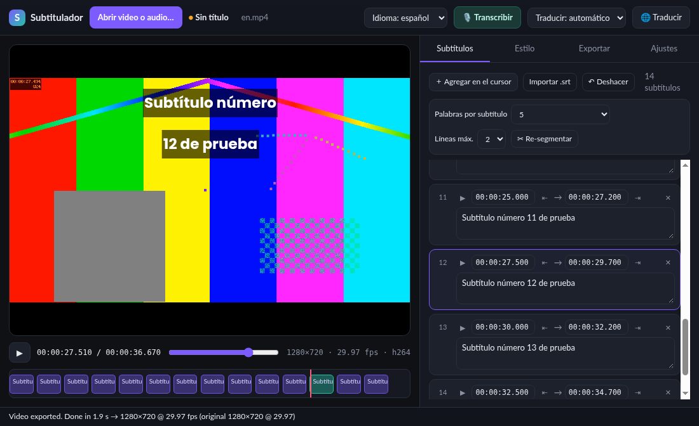
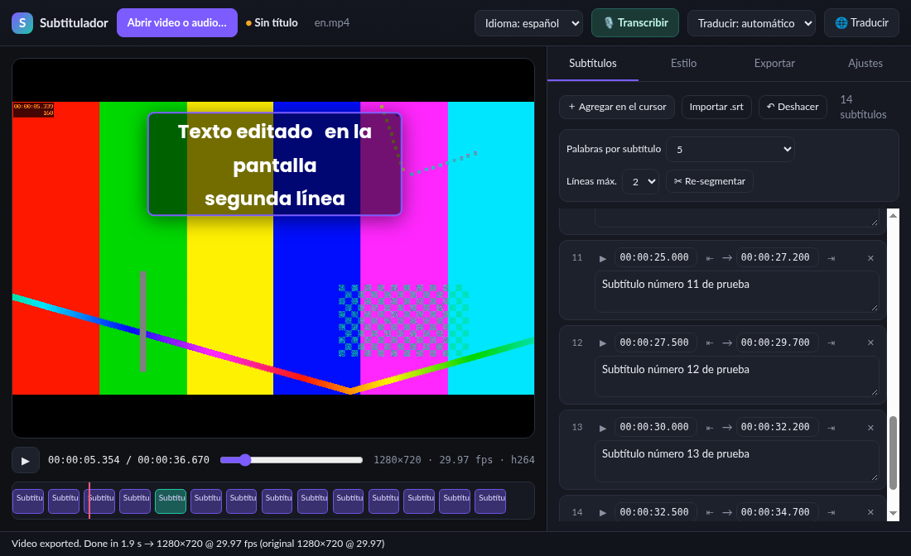

# Subtitulador

**Subtítulos con IA local para macOS: transcribí, traducí EN↔ES, dales estilo y quemalos en el video.**

🇬🇧 [Read in English](README.md)

Subtitulador convierte un video (o audio) en subtítulos con estilo, todo en tu Mac: sin cuenta, sin subir nada, sin suscripción. El reconocimiento de voz y la traducción corren localmente; después de descargar el modelo la primera vez, funciona sin internet.


## Por qué lo hice
Esto empezó como un experimento. Subtitulaba mis videos con CapCut, y ahí los subtítulos automáticos son pagos. Así que probé otra cosa: armar mi propia herramienta con IA. La fui dirigiendo, siguiendo el código mientras se escribía y probando cada versión yo mismo hasta que hizo lo que necesitaba. Es gratis, corre en tu Mac y tus videos nunca salen de tu computadora. Si te sirve, usala.

— Adolfo


## Funciones
- **Transcripción con Whisper** (tiny → large-v3-turbo), detección automática inglés/español o manual, con **tiempos por palabra**. GPU (WebGPU) o CPU.
- **Traducción inglés ↔ español** (Opus-MT), manteniendo los tiempos.
- **Editor de subtítulos**: texto y tiempos, palabras por subtítulo (1–15 o automático), 1–2 líneas, re-segmentar, deshacer.
- Clic en un bloque de la línea de tiempo para saltar a ese subtítulo; doble clic en el subtítulo del video para editarlo ahí mismo.
- **Editor de estilo con vista previa** idéntica al resultado final: fuente (Google Fonts incluidas o del sistema), tamaño, colores, borde, **sombra sólida o difuminada**, caja de fondo, **interlineado**, posición (arriba/centro/abajo o arrastrando). Presets propios.
- **Exportación**
  - Video con subtítulos quemados, misma resolución y fps: H.264, HEVC o ProRes 422 HQ (audio sin recomprimir).
  - **Video solo con subtítulos** para editores: ProRes 4444 **con transparencia**, o fondo verde/negro.
  - `.srt` y `.ass` con estilo.
- **Proyectos** (`.subtitulador`): guardar/abrir, recientes, aviso de cambios sin guardar, re-vincular videos movidos, doble clic para abrir.
- **Interfaz en español o inglés** (según el idioma del sistema; se cambia en Ajustes o en el menú Idioma).

## Cómo se usa
1. **Abrí un video**: botón *Abrir video o audio…* o arrastrá el archivo a la ventana.
2. **Transcribí**: elegí el idioma (o *detectar*) y tocá *Transcribir*. La primera vez descarga el modelo.
3. **Traducí** (opcional): inglés → español o español → inglés. Los tiempos se mantienen.
4. **Editá**:
   - Clic en un bloque de la línea de tiempo para saltar directo a ese subtítulo en la lista, listo para escribir.
   - Doble clic en el subtítulo del video para editarlo ahí mismo. Enter guarda, Shift+Enter agrega un salto de línea, Esc cancela.
   - Ajustá palabras por subtítulo y líneas, corregí los tiempos o deshacé con ⌘Z.
5. **Dale estilo**: fuente, tamaño, colores, borde, sombra, caja de fondo, interlineado y posición. También podés arrastrar el subtítulo sobre el video.
6. **Exportá**: video con los subtítulos quemados, video solo con subtítulos y fondo transparente para tu editor, o archivos `.srt` / `.ass`.
7. **Guardá el proyecto** (⌘S) para seguir después.

| Clic en la línea de tiempo | Doble clic para editar en el video |
|---|---|
|  |  |

## Descarga
Bajá la última versión desde **[Releases](https://github.com/adolfosmrr/subtitleapp/releases/latest)**:
### [⬇ Descargar para Mac con Apple Silicon (M1, M2, M3, M4…)](https://github.com/adolfosmrr/subtitleapp/releases/download/v1.3.2/Subtitulador-1.3.2-mac-arm64.zip)
### [⬇ Descargar para Mac con Intel](https://github.com/adolfosmrr/subtitleapp/releases/download/v1.3.2/Subtitulador-1.3.2-mac-x64.zip)

Los archivos también están en **Assets**, abajo de todo en la página del Release. [Hashes (SHA256SUMS.txt)](https://github.com/adolfosmrr/subtitleapp/releases/download/v1.3.2/SHA256SUMS.txt)

¿No sabés cuál tenés? Menú  › *Acerca de esta Mac*: si dice "Chip Apple M…", es Apple Silicon. Requiere macOS 12 o posterior.

## Instalación
1. Doble clic en el `.zip` para extraer **Subtitulador.app** y arrastrala a **Aplicaciones**.
2. **Primera apertura (la app no está firmada ni notarizada por Apple):**
   - Clic derecho (o Control + clic) sobre **Subtitulador** › **Abrir**, y de nuevo **Abrir**. Solo la primera vez.
   - En macOS 15 Sequoia o posterior, si no aparece "Abrir": **Ajustes del Sistema › Privacidad y seguridad**, bajá hasta el aviso de "Subtitulador" y tocá **Abrir igualmente**.
   - O en la Terminal (también arregla el aviso de "app dañada"):
     ```bash
     xattr -dr com.apple.quarantine /Applications/Subtitulador.app
     ```
3. La primera transcripción descarga el modelo de Whisper (Ajustes › Modelo; "Small" ≈ 500 MB). Los modelos quedan en `~/Library/Application Support/Subtitulador`.

## Verificá la descarga
Bajá Subtitulador solamente desde la página de **[Releases](https://github.com/adolfosmrr/subtitleapp/releases)** de este repositorio. La app no tiene actualizador automático, así que nadie puede meter código en tu Mac a través de ella: las versiones nuevas las instalás vos, desde acá.

Cada versión publica el SHA-256 de cada zip en `SHA256SUMS.txt`. Antes de abrir la app, verificalo en la Terminal:
```bash
cd ~/Downloads
shasum -a 256 Subtitulador-*-mac-*.zip
```
El valor tiene que coincidir exactamente con el de `SHA256SUMS.txt`. Si no coincide, borrá el archivo y avisá (ver [SECURITY.md](SECURITY.md)).

## Privacidad y seguridad
- Todo corre en tu computadora. La única conexión es la descarga única de los modelos desde `huggingface.co`, fijados a revisiones exactas.
- La ventana no puede navegar a otras páginas ni abrir ventanas, no tiene acceso a Node.js (renderer aislado y en sandbox) y usa una política de contenido (CSP) estricta.
- El ffmpeg incluido es una versión fija verificada por SHA-256 al compilar, y solo lee formatos de medios locales (sin red ni listas de reproducción).
- Los proyectos (`.subtitulador`) se validan campo por campo al abrirlos.
- Los "fuses" de Electron están endurecidos: sin `ELECTRON_RUN_AS_NODE`, sin `NODE_OPTIONS`, sin flags de inspector, y el código solo se carga desde su archivo con verificación de integridad.

## Cómo funciona
1. **Transcripción:** [Whisper](https://github.com/openai/whisper) corre en tu Mac y devuelve cada palabra con su propio tiempo.
2. **Segmentación:** las palabras se agrupan en subtítulos según tus ajustes de palabras por subtítulo y líneas, cortando las líneas por el ancho real del texto.
3. **Traducción (opcional):** [Opus-MT](https://github.com/Helsinki-NLP/Opus-MT) traduce inglés ↔ español frase por frase y mantiene los tiempos originales.
4. **Edición y estilo:** editás todo en la app. La vista previa reproduce las métricas de libass, así que lo que ves es lo que sale.
5. **Exportación:** el **ffmpeg + libass** incluido quema los subtítulos en el video con la misma resolución y fps, o exporta un clip solo con subtítulos en ProRes 4444 transparente / fondo verde / negro, o archivos `.srt` / `.ass`.

Whisper y Opus-MT corren con [transformers.js](https://github.com/huggingface/transformers.js) (ONNX Runtime, WebGPU o CPU) dentro de una app Electron. **Todo es local:** la única conexión es la descarga única de los modelos desde Hugging Face; después funciona sin internet.

## Compilar desde el código
Requisitos: Node.js 20+ y npm. `npm start` abre la app en modo desarrollo (antes descarga el runtime de transformers.js y ffmpeg); `npm run dist:mac` genera `dist/Subtitulador-<ver>-mac-{arm64,x64}.zip`.
```bash
git clone https://github.com/adolfosmrr/subtitleapp.git
cd subtitleapp
npm install
npm start
npm run dist:mac
```
Para firmar ad-hoc (necesario en Apple Silicon) instalá [rcodesign](https://github.com/indygreg/apple-platform-rs) o definí `RCODESIGN=/ruta/a/rcodesign`.

## Créditos y licencias
Subtitulador es © 2026 Adolfo Mesen, con [licencia MIT](LICENSE). Usa Electron, transformers.js, ONNX Runtime, Whisper (OpenAI), Opus-MT (Helsinki-NLP), FFmpeg con libass (el binario de ffmpeg incluido es GPL v3) y fuentes de Google Fonts. Ver [THIRD_PARTY_NOTICES.md](THIRD_PARTY_NOTICES.md).
