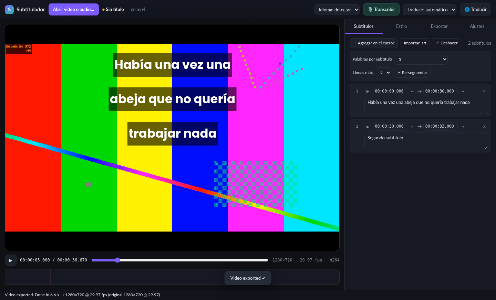

# Subtitulador

**Subtítulos con IA local para macOS: transcribí, traducí EN↔ES, dales estilo y quemalos en el video.**

🇬🇧 [Read in English](README.md)

Subtitulador convierte un video (o audio) en subtítulos con estilo, todo en tu Mac: sin cuenta, sin subir nada, sin suscripción. El reconocimiento de voz y la traducción corren localmente; después de descargar el modelo la primera vez, funciona sin internet.



## Funciones
- **Transcripción con Whisper** (tiny → large-v3-turbo), detección automática inglés/español o manual, con **tiempos por palabra**. GPU (WebGPU) o CPU.
- **Traducción inglés ↔ español** (Opus-MT), manteniendo los tiempos.
- **Editor de subtítulos**: texto y tiempos, palabras por subtítulo (1–15 o automático), 1–2 líneas, re-segmentar, deshacer.
- **Editor de estilo con vista previa** idéntica al resultado final: fuente (Google Fonts incluidas o del sistema), tamaño, colores, borde, **sombra sólida o difuminada**, caja de fondo, **interlineado**, posición (arriba/centro/abajo o arrastrando). Presets propios.
- **Exportación**
  - Video con subtítulos quemados, misma resolución y fps: H.264, HEVC o ProRes 422 HQ (audio sin recomprimir).
  - **Video solo con subtítulos** para editores: ProRes 4444 **con transparencia**, o fondo verde/negro.
  - `.srt` y `.ass` con estilo.
- **Proyectos** (`.subtitulador`): guardar/abrir, recientes, aviso de cambios sin guardar, re-vincular videos movidos, doble clic para abrir.
- **Interfaz en español o inglés** (según el idioma del sistema; se cambia en Ajustes o en el menú Idioma).

## Descarga
Bajá la última versión desde **[Releases](https://github.com/adolfosmrr/subtitulador/releases/latest)**:
- **Apple Silicon (M1, M2, M3, M4…)** → `Subtitulador-<versión>-mac-arm64.zip`
- **Mac con Intel** → `Subtitulador-<versión>-mac-x64.zip`

¿No sabés cuál tenés? Menú  › *Acerca de esta Mac*: si dice "Chip Apple M…", es Apple Silicon. Requiere macOS 12 o posterior.

## Instalación
1. Doble clic en el `.zip` para extraer **Subtitulador.app** y arrastrala a **Aplicaciones**.
2. **Primera apertura (la app no está firmada ni notarizada por Apple):**
   - Clic derecho (o Control + clic) sobre **Subtitulador** › **Abrir**, y de nuevo **Abrir**. Solo la primera vez.
   - En macOS 15 Sequoia o posterior, si no aparece "Abrir": **Ajustes del Sistema › Privacidad y seguridad**, bajá hasta el aviso de "Subtitulador" y tocá **Abrir igualmente**.
   - O en la Terminal (también arregla el aviso de "app dañada"):
     ```bash
     xattr -dr com.apple.quarantine /Applications/Subtitulador.app
     ```
3. La primera transcripción descarga el modelo de Whisper (Ajustes › Modelo; "Small" ≈ 500 MB). Los modelos quedan en `~/Library/Application Support/Subtitulador`.

## Cómo funciona
- App **Electron**. Whisper y Opus-MT corren con **[transformers.js](https://github.com/huggingface/transformers.js)** (ONNX Runtime Web, WebGPU o WASM) en un worker: nada sale de tu computadora salvo la descarga única de los modelos desde Hugging Face.
- Los subtítulos se renderizan con **ffmpeg + libass** (formato ASS). La vista previa reproduce las métricas de libass (métricas OS/2 de la fuente, posición de cada línea, difuminado de la sombra), así que lo que ves es lo que sale.

## Compilar desde el código
Requisitos: Node.js 20+ y npm.
```bash
git clone https://github.com/adolfosmrr/subtitulador.git
cd subtitulador
npm install
npm start               # modo desarrollo (descarga runtime de transformers.js y ffmpeg)
npm run dist:mac        # genera dist/Subtitulador-<ver>-mac-{arm64,x64}.zip
```
Para firmar ad-hoc (necesario en Apple Silicon) instalá [rcodesign](https://github.com/indygreg/apple-platform-rs) o definí `RCODESIGN=/ruta/a/rcodesign`.

## Créditos y licencias
Subtitulador es © 2026 Adolfo Mesen, con [licencia MIT](LICENSE). Usa Electron, transformers.js, ONNX Runtime, Whisper (OpenAI), Opus-MT (Helsinki-NLP), FFmpeg con libass (el binario de ffmpeg incluido es GPL v3) y fuentes de Google Fonts. Ver [THIRD_PARTY_NOTICES.md](THIRD_PARTY_NOTICES.md).
