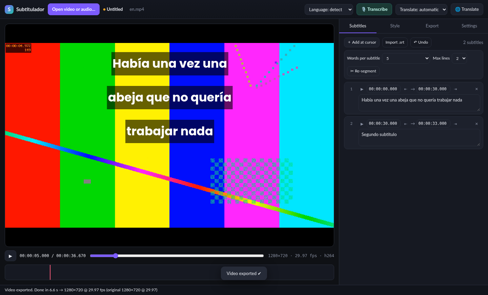
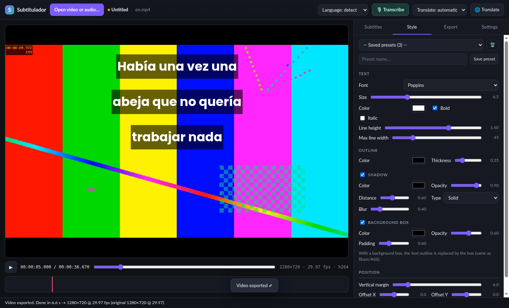
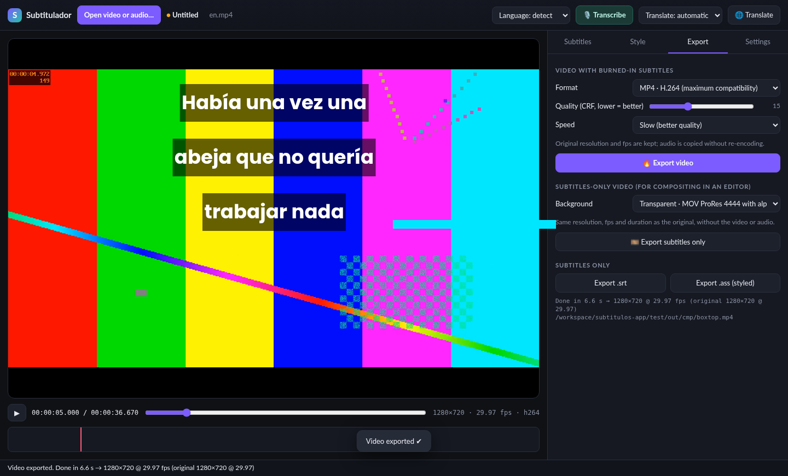
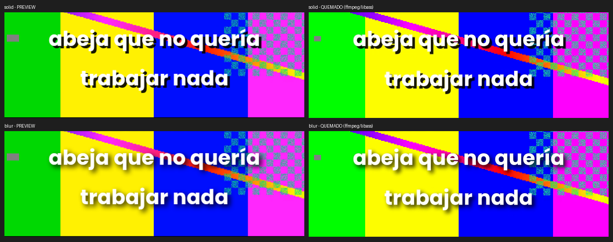

# Subtitulador

**Local AI subtitles for macOS: transcribe, translate EN↔ES, style & burn-in.**

🇪🇸 [Leer en español](README.es.md)

Subtitulador turns a video (or audio) into styled subtitles entirely on your Mac — no account, no upload, no subscription. Speech recognition and translation run locally; after the first model download it works offline.



## Features
- **Transcription with Whisper** (tiny → large-v3-turbo), English/Spanish auto-detect or manual, with **per-word timestamps**. GPU (WebGPU) with CPU fallback.
- **Translation English ↔ Spanish** (Opus-MT), keeping the timings.
- **Subtitle editor**: text and timings, words per subtitle (1–15 or automatic), 1–2 lines, re-segment, undo.
- Click a timeline block to jump to that subtitle; double-click the subtitle on the video to edit it in place.
- **Style editor with live preview** that matches the final render exactly: font (bundled Google Fonts or system fonts), size, color, outline, **solid or blurred shadow**, background box, **line height**, position (top/middle/bottom or drag anywhere). Save your own presets.
- **Export**
  - Video with burned-in subtitles at the original resolution and frame rate: H.264, HEVC or ProRes 422 HQ (audio copied).
  - **Subtitles-only video** for editors: ProRes 4444 **with transparency**, or green/black background.
  - `.srt` and styled `.ass`.
- **Projects** (`.subtitulador`): save/open, recent files, unsaved-changes prompt, relink moved videos, double-click to open.
- **English or Spanish interface** (follows the system language; change it in Settings or the Language menu).

| Style | Export | Blurred vs solid shadow (preview vs render) |
|---|---|---|
|  |  |  |

## Download
Get the latest version from **[Releases](https://github.com/adolfosmrr/subtitulador/releases/latest)**:
- **Apple Silicon (M1, M2, M3, M4…)** → `Subtitulador-<version>-mac-arm64.zip`
- **Intel Mac** → `Subtitulador-<version>-mac-x64.zip`

Not sure? Apple menu  › *About This Mac*: "Chip Apple M…" means Apple Silicon. Requires macOS 12 or later.

## Install
1. Double-click the `.zip` to extract **Subtitulador.app** and drag it to **Applications**.
2. **First launch (the app is not signed/notarized by Apple):**
   - Right-click (or Control-click) **Subtitulador** › **Open**, then **Open** again. Only needed once.
   - On macOS 15 Sequoia or later, if there is no "Open" button: **System Settings › Privacy & Security**, scroll to the "Subtitulador" message and click **Open Anyway**.
   - Or in Terminal (also fixes "app is damaged"):
     ```bash
     xattr -dr com.apple.quarantine /Applications/Subtitulador.app
     ```
3. The first transcription downloads the Whisper model (Settings › Model; "Small" ≈ 500 MB). Models are cached in `~/Library/Application Support/Subtitulador`.

## Verify your download
Only download Subtitulador from this repository's **[Releases](https://github.com/adolfosmrr/subtitulador/releases)** page. The app has no auto-updater, so nobody can push code to your Mac through it: you install new versions yourself, from here.

Every release lists the SHA-256 of each zip in `SHA256SUMS.txt`. Before opening the app, check it in Terminal:
```bash
cd ~/Downloads
shasum -a 256 Subtitulador-*-mac-*.zip
```
The value must match the line in `SHA256SUMS.txt` exactly. If it doesn't, delete the file and report it (see [SECURITY.md](SECURITY.md)).

## Privacy & security
- Everything runs locally. The only network access is the one-time model download from `huggingface.co`, pinned to fixed model revisions.
- The window can't navigate away or open other pages, has no Node.js access (sandboxed renderer, context isolation), and uses a strict Content Security Policy.
- The bundled ffmpeg is a pinned build verified by SHA-256 at build time. It only reads local media formats (no network or playlist inputs).
- Project files (`.subtitulador`) are validated field by field when opened.
- Electron fuses are hardened: no `ELECTRON_RUN_AS_NODE`, no `NODE_OPTIONS`, no inspector flags, and the app code is only loaded from its integrity-checked archive.

## How it works
- **Electron** app. Whisper and Opus-MT run with **[transformers.js](https://github.com/huggingface/transformers.js)** (ONNX Runtime Web, WebGPU or WASM) in a worker — nothing leaves your computer except the one-time model download from Hugging Face.
- Subtitles are rendered with **ffmpeg + libass** (ASS format). The preview reproduces libass metrics (font OS/2 metrics, line positions, shadow blur) so what you see is what you get.
- Line wrapping is computed in the app and every line is written as its own positioned ASS event, which makes line height controllable and identical in preview and render.

## Build from source
Requirements: Node.js 20+, npm. `npm start` runs the app in development mode (it fetches the transformers.js runtime and ffmpeg first); `npm run dist:mac` builds `dist/Subtitulador-<ver>-mac-{arm64,x64}.zip`.
```bash
git clone https://github.com/adolfosmrr/subtitulador.git
cd subtitulador
npm install
npm start
npm run dist:mac
```
- `scripts/fetch-ffmpeg.js` downloads static ffmpeg binaries (ffmpeg-static b6.0) into `vendor-bin/` and verifies their SHA-256.
- macOS builds can be made on Linux; for an ad-hoc signature (needed on Apple Silicon) install [rcodesign](https://github.com/indygreg/apple-platform-rs) or set `RCODESIGN=/path/to/rcodesign`.
- `npm test` (transcribe → translate → style → burn) and `npm run test:compare` (preview vs. render, overlays, projects) run the real app under `xvfb` on Linux. They need sample videos in `test/samples/` (not included).

## Credits & licenses
Subtitulador is © 2026 Adolfo Mesen, released under the [MIT License](LICENSE).
It uses [Electron](https://www.electronjs.org/), [transformers.js](https://github.com/huggingface/transformers.js), [ONNX Runtime](https://onnxruntime.ai/), OpenAI [Whisper](https://github.com/openai/whisper), Helsinki-NLP [Opus-MT](https://github.com/Helsinki-NLP/Opus-MT), [FFmpeg](https://ffmpeg.org/) with [libass](https://github.com/libass/libass) (the bundled ffmpeg binary is GPL v3), and fonts from [Google Fonts](https://fonts.google.com/). See [THIRD_PARTY_NOTICES.md](THIRD_PARTY_NOTICES.md).
